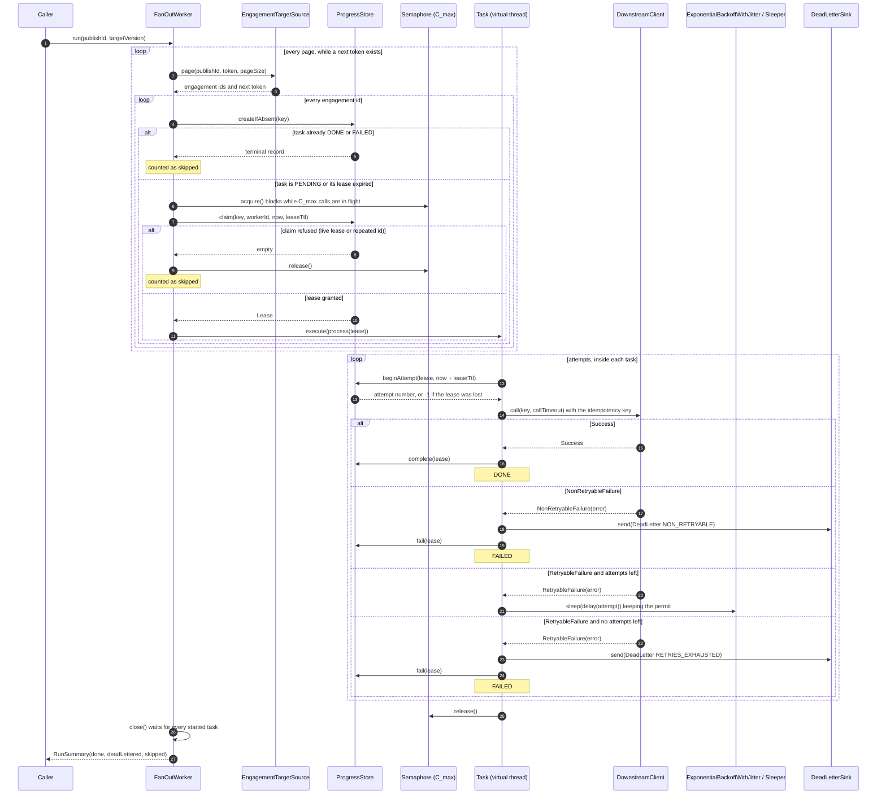

# 🧪 caseware-technical-test

[](https://github.com/Jiliar/caseware-technical-test/actions/workflows/ci.yml)

This repository holds my answer to Caseware's **Staff Java Developer take-home exercise**:

- 📐 **Part 1**, the architecture and design, is in `docs`.
- 💻 **Part 2**, the template-publish fan-out worker in Java, is in `src`.

## 🗂️ Project structure

```text
caseware-technical-test/
├── .github/workflows/ci.yml  CI: unit tests (Maven) and logic validation (JDK only)
├── docs/                     Part 1: architecture and design
├── src/main/java/com/caseware/fanout/   13 files, ~590 lines
│   ├── model/      IdempotencyKey, FanOutConfig (validated), RunSummary
│   ├── port/       contracts: EngagementTargetSource, DownstreamClient, ProgressStore, DeadLetterSink, Clock, Sleeper
│   ├── worker/     FanOutWorker (paging, C_max semaphore, lease, retry, DLQ), ExponentialBackoffWithJitter
│   └── inmemory/   InMemoryProgressStore (compare-and-set per key), SystemClock
├── src/test/java/com/caseware/fanout/
│   ├── fakes/      FakeClock, FakeDownstreamClient, WorkerFixture (no test library)
│   ├── validation/ LogicValidation: plain-JDK scenario checks
│   └── worker/, inmemory/, model/   JUnit tests
└── pom.xml, mvnw, mvnw.cmd   Maven build for the unit tests (the wrapper downloads Maven)
```

## ✅ Tests or validation logic

🔍 **Logic validation, without Maven** (JDK 25 only):

```bash
javac --release 25 -d target/validation $(find src/main -name '*.java') $(find src/test/java/com/caseware/fanout/fakes src/test/java/com/caseware/fanout/validation -name '*.java')
java -cp target/validation com.caseware.fanout.validation.LogicValidation
```

Each scenario prints its theme, `INPUT` (configuration and setup), `OUTPUT` (what was observed), `EXPECTED` and `RESULT: PASS|FAIL`, then a summary table. The exit code is 0 only if every scenario passes. A fake clock replaces real waiting, so the run takes well under a second.

🧱 **Unit tests** (JUnit and AssertJ): `./mvnw verify`.

🚀 **CI.** [`.github/workflows/ci.yml`](.github/workflows/ci.yml) runs on push, on pull request and on manual dispatch. It has two jobs:

- `unit-tests` runs `./mvnw verify`.
- `logic-validation` runs the `javac` and `java LogicValidation` commands above, without Maven. It also writes the output to the job summary.

Both jobs run exactly the commands shown above, so a local run matches the CI run.

📈 **Where to see the results.** Open the [Actions tab](https://github.com/Jiliar/caseware-technical-test/actions) of the repository, or the badge at the top, which links to the workflow runs. Example run: [#39893638303](https://github.com/Jiliar/caseware-technical-test/actions/runs/39893638303).

- The `logic-validation` job prints every scenario (`INPUT`, `OUTPUT`, `EXPECTED`, `RESULT`) in its log and repeats the output in the run **Summary** page.
- The `unit-tests` job shows the Maven test results in its log and uploads the Surefire reports as the `surefire-reports` artifact of the run.

## ⚙️ The worker (Part 2)

For one template publication, `FanOutWorker` calls a slow (~1 min per engagement) downstream service owned by another team, once per target engagement. It reads the targets page by page and claims each task with a lease in `ProgressStore`. Each claimed task runs on a virtual thread, and at most `C_max` calls are ever in flight. Failures are retried with exponential backoff and jitter, up to the maximum number of attempts, and then go to the dead-letter queue (DLQ). Non-retryable errors go to the DLQ at once.

🛟 **Recovery model.** If a worker dies, its leases expire. Running the same publication again reclaims those tasks and skips the DONE ones. A task still leased by a live worker is skipped, and a later run picks it up once that lease has expired.

⏱️ **What the ~1-minute call is for.** It verifies and classifies engagements whose base version is unknown. Whether an engagement is "pending" comes from the index, which does not call this downstream.

🧮 **Arithmetic.** `duration ≈ N engagements × ~1 min / C_max`, where `C_max` is the capacity agreed with the downstream owner. A large publication takes hours, so the worker runs in the background. Every number in the tests is an example and can be configured.

### 📥📤 Inputs and outputs

The take-home does not list inputs and outputs; they follow from its text: a template publication triggers the worker, it must process "a large number of engagements", and each one goes through a ~1-minute downstream call owned by another team with limited capacity.

#### 📥 Inputs

| Input | Where it enters the code | What it is |
| --- | --- | --- |
| 🚦 Publication to process | `FanOutWorker.run(publishId, targetVersion)` | Which publication and which target template version to fan out. The caller triggers the run; no real event listener is included. |
| 📄 Engagements to process | `EngagementTargetSource.page(publishId, token, pageSize)` | The target engagement ids, one page at a time. Reading pauses while capacity is full, so a huge publication is never loaded at once. |
| 📨 Downstream answers | `DownstreamClient.call(key, timeout)` | `Success`, `RetryableFailure(error)` or `NonRetryableFailure(error)` for each engagement. |
| 💾 Saved task state | `ProgressStore` | The state left by earlier runs: DONE and FAILED tasks are skipped, an expired lease can be reclaimed. |
| 🎛️ Configuration | `FanOutConfig` | `C_max`, page size, maximum attempts, call timeout, lease TTL and backoff settings (all validated; the numbers in tests are examples). |
| 🕒 Time | `Clock`, `Sleeper` | Injected, so tests and the validation never wait in real time. |

#### 📤 Outputs

| Output | Where it comes out | What it is |
| --- | --- | --- |
| 📞 One downstream call per engagement | `DownstreamClient.call(key, timeout)` | Sent with the key `publishId:engagementId:targetVersion`. Never more than `C_max` at the same time, retried with backoff and jitter on retryable errors, and never repeated for a task that is already DONE. |
| 🔁 Task state changes | `ProgressStore` | PENDING → IN_PROGRESS (with a lease) → DONE or FAILED. Another run uses this to resume without repeating work. |
| ☠️ Dead letters | `DeadLetterSink.send(DeadLetter)` | One record per task that failed for good: the key, the reason (`NON_RETRYABLE` or `RETRIES_EXHAUSTED`), the attempts, the last error and the time. |
| 📊 Run result | returned by `run(...)` as `RunSummary(done, deadLettered, skipped)` | How many tasks finished, went to the DLQ, or were skipped (already finished, or leased by a live worker). |

### 🔄 Interaction sequence

How `FanOutWorker` talks to its ports for one publication (`run(publishId, targetVersion)`). Each claimed task runs on its own virtual thread.



### ⚖️ Key tradeoffs

1. **Virtual threads instead of a fixed pool.** Blocking for ~1 min is cheap on a virtual thread, and the code stays sequential. Virtual threads do not limit themselves, so an explicit `Semaphore(C_max)` sets the limit. The permit is taken *before* the next claim, so reading pauses while capacity is full: read-but-unfinished tasks never exceed `C_max + pageSize`.
2. **In-memory store behind an interface.** `ProgressStore` does compare-and-set per key. In production the same contract maps to DynamoDB conditional writes on status, lease owner and version.
3. **At-least-once plus idempotency instead of exactly-once.** Every call carries `publishId:engagementId:targetVersion`, so a retry, a reclaimed task or a republish never repeats the effect. A late result from a worker that lost its lease is rejected.
4. **The permit is kept during backoff.** This makes the permit count an exact bound on calls. The cost is that a task in backoff holds capacity it is not using. Each attempt renews the lease, so `leaseTtl > callTimeout + backoffCap` is enough.
5. **Recovery by lease expiry on re-run.** There is no heartbeat thread and no coordinator, only leases with a TTL. A crashed worker's tasks wait one lease TTL before another run can take them.

### 🧩 Design patterns used

| Pattern | Where | Why |
| --- | --- | --- |
| Ports and Adapters | the six interfaces in `port`; `InMemoryProgressStore`, `SystemClock` | Every external system is a contract, swapped for a fake or a real adapter without touching the worker |
| Sealed result with pattern-matching `switch` | `DownstreamClient.Result` (`Success`, `RetryableFailure`, `NonRetryableFailure`) in `FanOutWorker` | Errors are classified values; the compiler checks that every case is handled |
| State | `ProgressStore.Status` and the transitions in `InMemoryProgressStore` | Only legal transitions: DONE and FAILED are terminal and never claimed again |
| Lease | `ProgressStore.Lease`, `claim`, `beginAttempt` | Crash recovery without locks: an expired lease can be reclaimed, and a stale holder's writes fail |
| Idempotent Receiver | `IdempotencyKey`, DONE tasks skipped, DLQ deduplicated by key | At-least-once delivery without a double effect |
| Bounded producer–consumer | `Semaphore(C_max)` taken before each claim in `FanOutWorker.run` | Caps downstream concurrency and how far ahead pages are read |
| Test doubles (fakes) | `FakeClock`, `FakeDownstreamClient`, `InMemoryProgressStore` | Deterministic tests with no real waiting |

### 🎯 Behaviours, tests and validation scenarios

| Behaviour | JUnit test | Scenario |
| --- | --- | --- |
| Never more than `C_max` simultaneous calls, with 40,000 tasks | `ConcurrencyLimitTest` | 1 |
| A large publish is read only as far as the tasks in flight allow | `BoundedReadingTest` | 2 |
| Retryable errors back off exponentially with jitter, then succeed | `ExponentialBackoffWithJitterTest` | 3 |
| Exhausted retries and non-retryable errors go to the DLQ | `DeadLetterTest` | 4 |
| A retry, a republish or a new target version never duplicates an effect | `IdempotencyTest` | 5 |
| After a crash, work resumes once the leases expire and DONE tasks are not repeated | `LeaseRecoveryTest` | 6 |
| Store claims are atomic and stale leases are rejected | `InMemoryProgressStoreTest` | 7 |
| Invalid configuration is rejected | `FanOutConfigTest` | — |

### 🧾 Evidence: output of the logic validation

The CI run [#39893638303](https://github.com/Jiliar/caseware-technical-test/actions/runs/39893638303) executes the two commands of the *Tests or validation logic* section. The `logic-validation` job prints the output below in its log and repeats it in the run Summary. This is the complete output of the same commands run with JDK 25; backoff delays and the winner of the claim in scenario 7 are random, so those values differ from run to run, while every `RESULT` and the summary stay the same.

<details>
<summary>Show the full output (7 scenarios, all PASS, exit code 0)</summary>

```text
[Scenario 1] Concurrency limit with a large publish
  THEME:    CONCURRENCY, DOWNSTREAM CAPACITY
  INPUT:    engagements=40000, publication=publish-1, target version=v2, C_max=50, max attempts=4, page size=100 (example configurable), every call succeeds
  OUTPUT:   peak simultaneous downstream calls=50, total calls=40000
  OUTPUT:   tasks DONE in store=40000, RunSummary[done=40000, deadLettered=0, skipped=0]
  EXPECTED: peak <= C_max (50) and reached; all 40000 tasks DONE, one call each
  RESULT:   PASS

[Scenario 2] Large publish: bounded reading
  THEME:    CONCURRENCY, DOWNSTREAM CAPACITY
  INPUT:    engagements=500, publication=publish-1, target version=v2, C_max=8, max attempts=4, page size=10 (example configurable), downstream blocked until the reader has stopped
  OUTPUT:   while blocked: pages requested=1, targets read=10, calls in flight=8
  OUTPUT:   max read-but-unfinished when asking for a page=7, page requests=50, RunSummary[done=500, deadLettered=0, skipped=0]
  EXPECTED: read-but-unfinished never above C_max + pageSize (18); at a page request never above C_max (8); all DONE
  RESULT:   PASS

[Scenario 3] Retryable errors, then success
  THEME:    FAILURE, DOWNSTREAM CAPACITY
  INPUT:    engagements=1, publication=publish-1, target version=v2, C_max=4, max attempts=5, page size=10 (example configurable), backoff base=1000 ms, factor=2.0, cap=30000 ms, full jitter
  INPUT:    injected: 3 retryable failures (503), then success
  OUTPUT:   backoff after attempt 1: 156 ms (ceiling 1000 ms)
  OUTPUT:   backoff after attempt 2: 1582 ms (ceiling 2000 ms)
  OUTPUT:   backoff after attempt 3: 2543 ms (ceiling 4000 ms)
  OUTPUT:   attempts=4, calls=4, status=DONE, effects=1
  EXPECTED: 4 attempts, 3 delays each in [0, ceiling] with ceilings 1 s, 2 s, 4 s; DONE with one effect
  RESULT:   PASS

[Scenario 4] Retries exhausted and non-retryable errors go to the DLQ
  THEME:    FAILURE
  INPUT:    engagements=1, publication=publish-1, target version=v2, C_max=4, max attempts=4, page size=10 (example configurable)
  INPUT:    case A: every call fails with a retryable error (503); case B: non-retryable error (400)
  OUTPUT:   case A: calls=4, backoffs=3, status=FAILED, RunSummary[done=0, deadLettered=1, skipped=0]
  OUTPUT:   case A dead letter: key=publish-1:eng-0:v2, reason=RETRIES_EXHAUSTED, attempts=4, lastError=503 Service Unavailable
  OUTPUT:   case B: calls=1, backoffs=0, status=FAILED, RunSummary[done=0, deadLettered=1, skipped=0]
  OUTPUT:   case B dead letter: key=publish-1:eng-0:v2, reason=NON_RETRYABLE, attempts=1, lastError=400 Bad Request
  EXPECTED: A: 4 calls, one RETRIES_EXHAUSTED letter, FAILED; B: 1 call, no backoff, one NON_RETRYABLE letter, FAILED
  RESULT:   PASS

[Scenario 5] Retry, republish and new target version
  THEME:    IDEMPOTENCY
  INPUT:    (a) engagements=1, publication=publish-1, target version=v2, C_max=4, max attempts=4, page size=10 (example configurable); first call applies the effect but answers TIMEOUT
  INPUT:    (b) engagements=200, publication=publish-1, target version=v2, C_max=8, max attempts=4, page size=25 (example configurable); the same publication is published twice
  INPUT:    (c) then target version v3 of the same publication
  OUTPUT:   (a) key publish-1:eng-0:v2: calls=2, effects=1, status=DONE
  OUTPUT:   (b) first run calls=200; republish new calls=0, effects=200, RunSummary[done=0, deadLettered=0, skipped=200]
  OUTPUT:   (c) new-version calls=200, total effects=400, RunSummary[done=200, deadLettered=0, skipped=0]
  EXPECTED: (a) 2 calls, 1 effect, DONE; (b) 0 new calls, all 200 skipped, effects unchanged; (c) 200 new keys, calls and effects
  RESULT:   PASS

[Scenario 6] Worker crash: resume after lease expiry
  THEME:    FAILURE, IDEMPOTENCY
  INPUT:    engagements=300, publication=publish-1, target version=v2, C_max=10, max attempts=4, page size=20 (example configurable), lease TTL=5 min
  INPUT:    worker A finishes 50 tasks, then freezes with C_max calls in flight; clock advances past the lease TTL; worker B runs the same publication
  OUTPUT:   at crash: DONE=50, IN_PROGRESS (leases left)=10
  OUTPUT:   worker B: RunSummary[done=250, deadLettered=0, skipped=50]
  OUTPUT:   worker A after waking: RunSummary[done=50, deadLettered=0, skipped=240] (its late completes were rejected)
  OUTPUT:   calls per task finished before the crash=1, max effects per key=1, DONE in store=300/300
  EXPECTED: B completes the 250 unfinished tasks and skips the 50 DONE ones; all DONE; 1 effect per key; A's late results discarded
  RESULT:   PASS

[Scenario 7] ProgressStore contract: atomic claim, stale lease rejected
  THEME:    CONCURRENCY, FAILURE
  INPUT:    100 threads claim key publish-1:eng-0:v2 at the same instant; lease TTL=5 min
  OUTPUT:   winners=[worker-3], claim while lease live=false, reclaim after expiry=true
  OUTPUT:   stale holder complete=false, new holder complete=true
  EXPECTED: exactly 1 winner; live lease protected; expired lease reclaimable; stale complete rejected
  RESULT:   PASS

SUMMARY
  PASS   [Scenario 1] Concurrency limit with a large publish
  PASS   [Scenario 2] Large publish: bounded reading
  PASS   [Scenario 3] Retryable errors, then success
  PASS   [Scenario 4] Retries exhausted and non-retryable errors go to the DLQ
  PASS   [Scenario 5] Retry, republish and new target version
  PASS   [Scenario 6] Worker crash: resume after lease expiry
  PASS   [Scenario 7] ProgressStore contract: atomic claim, stale lease rejected
7 scenarios, 0 failed, 264 ms
```

</details>

What each scenario proves in terms of the take-home themes:

| Scenario | Theme | Evidence in the output |
| --- | --- | --- |
| 1 | Concurrency, downstream capacity | 40,000 tasks, peak simultaneous calls = `C_max` (50), one call each |
| 2 | Concurrency, downstream capacity | With the downstream blocked, only 10 targets are read and 8 calls are in flight; reading never runs ahead of capacity |
| 3 | Failure | Three 503s, then success: 4 attempts, backoff delays 156, 1582 and 2543 ms below ceilings of 1, 2 and 4 s, one effect |
| 4 | Failure | Exhausted retries go to the DLQ after 4 calls; a non-retryable error goes after 1 call with no backoff |
| 5 | Idempotency | A retry after a timeout leaves 1 effect; a republish makes 0 new calls; a new target version creates new keys |
| 6 | Failure, idempotency | After a worker crash another run completes the 250 unfinished tasks and skips the 50 DONE ones; 1 effect per key |
| 7 | Concurrency, failure | 100 simultaneous claims have exactly 1 winner; a stale lease holder is rejected |

🚫 **Left out:** real adapters (HTTP client, DynamoDB, SQS), DLQ redrive tooling, and metrics.
